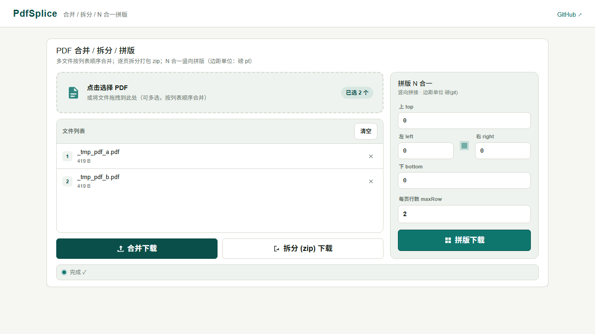

# PdfSplice 📄✂️

PDF 合并 / 拆分 / 拼版（N 合 1）小工具：跨平台 .NET 类库 + 可部署的 Blazor Web 工具站，拖拽上传、浏览器直下。

Merge / split / N-up splice your PDFs — cross-platform .NET library plus a self-contained Blazor web tool with drag-and-drop.

## ✨ 特性 / Features

- **合并**：多个 PDF 按顺序合一
- **拆分**：每页拆成一个独立 PDF
- **拼版**：每页 N 行竖向拼接（N-up），四边独立裁边距（罗盘式参数面板），省纸打印神器
- **跨平台**：基于 PdfSharpCore，Linux / macOS / Windows 全平台可用
- **零依赖起步**：工具站无数据库、无认证、无配置文件，`dotnet run` 即用



## 🚀 三步即用 / Quick Start

```bash
git clone https://github.com/fortunelover/PdfSplice.git
cd PdfSplice/PdfSplice.Web
dotnet run   # 打开控制台输出的 http://localhost:xxxx
```

> 国内 NuGet 还原慢可在 `%USERPROFILE%\.nuget\NuGet.Config` 配镜像（如华为云 `https://mirrors.huaweicloud.com/repository/nuget/v3/index.json`）。

## 📦 作为类库引用 / As a Library

```csharp
using PdfSplice.Core;

byte[] merged = PdfTools.Combine(pdfStreams);                    // 合并
List<byte[]> pages = PdfTools.Split(mergedStream);               // 拆分：每页一个文件
byte[] spliced = PdfTools.Splice(stream, new PdfSpliceOptions    // 拼版：2 合 1
{
    Top = 0, Bottom = 0, Left = 0, Right = 0, MaxRow = 2,
});
```

## 🧪 测试 / Tests

```bash
dotnet test PdfSplice.Core.Tests   # 夹具现场生成 PDF，页数断言
```

## 📄 License

[MIT](LICENSE)
